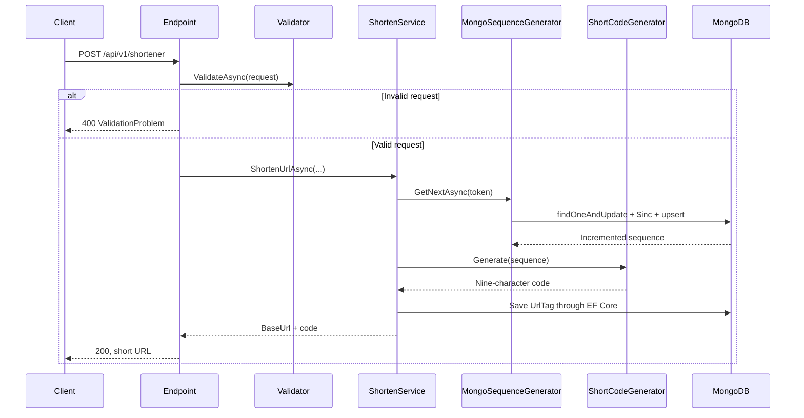
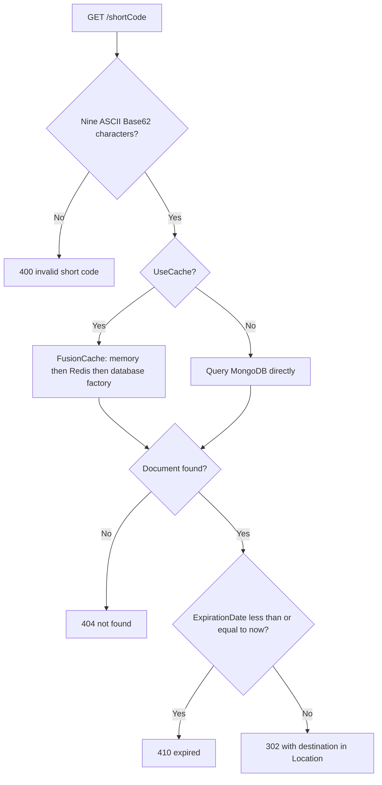

# Architecture and code map

## Service responsibility

The Shortener service owns short-link creation, code allocation, destination persistence, expiration checks, and redirect resolution. Each replica uses the same persistent MongoDB state. An optional Redis cache shares resolved destinations across replicas, while each replica also has a local memory cache.

The application is organized by responsibility within a single project. It does not introduce separate domain/application assemblies, a mediator, or repositories over the EF Core context. The current workflow is small enough to follow through direct service calls.

## Source map

Paths below are relative to `Src/Shortener.API/`.

| Location | Responsibility |
| --- | --- |
| [Program.cs](../../Src/Shortener.API/Program.cs) | Composition root, database initialization, HTTP routes, exception middleware, and metrics exporter |
| `Endpoints/` | Bind requests, invoke validation/services, and construct HTTP results |
| `Endpoints/Contracts/` | External request models |
| `Validators/` | FluentValidation rules for creation requests |
| `Services/ShortenService.cs` | Allocate a code, persist a link, and construct its public URL |
| `Services/RedirectService.cs` | Resolve through cache/database, check expiration, and record resolution metrics |
| `Services/ShortCodeGenerator.cs` | Deterministic keyed transformation and Base62 encoding |
| `Services/MongoSequenceGenerator.cs` | Atomic numeric allocation through the MongoDB driver |
| `Services/Interface/` | Contracts consumed by endpoints and services |
| `Services/DTOs/` | Minimal redirect cache payload |
| `Models/` | MongoDB document models |
| `Infrastructure/ShortenerURLContext.cs` | EF Core collection mapping and index declarations |
| `Infrastructure/Configurations/` | Typed application/cache settings |
| `Infrastructure/Extensions/` | Dependency registration and options binding |
| `Errors/` | Stable codes, central HTTP error catalog, result model, and error translation |
| `Exceptions/` | Exception classification and centralized Problem Details responses |
| `Observability/ShortDiagnostic.cs` | Application counters and duration histogram |

## Creation flow

The service increments its creation counter only after persistence succeeds. It does not deduplicate equal destination URLs: two valid creation requests normally create two separate links.

## Redirect flow

## Dependency lifetimes

| Dependency | Lifetime | Reason |
| --- | --- | --- |
| `ShortenerURLContext` | Scoped | EF Core context belongs to a request scope |
| `IShortenService`, `IRedirectService` | Scoped | Consume the scoped context |
| `IMongoClient`, `IMongoDatabase` | Singleton | Shared driver client/pool and database handle |
| `ISequenceGenerator` | Singleton | Uses a shared MongoDB collection handle |
| `IShortCodeGenerator` | Singleton | Reads its key once and performs stateless transformations |
| `TimeProvider`, `ErrorTranslator`, `ShortDiagnostic` | Singleton | Shared clock, translation, and metric instruments |

Cancellation tokens flow from endpoints into validation, cache resolution, MongoDB sequence allocation, EF queries, and persistence. The generator performs synchronous CPU work and does not need asynchronous scheduling.

## Boundaries for future integrations

Public clients currently use HTTP. Internal in-process calls remain direct. Independently deployed callers can use the existing HTTP contract; adding an internal RPC contract requires a concrete integration requirement. No click events, message broker, outbox, authentication scheme, or tenant model is implemented.
